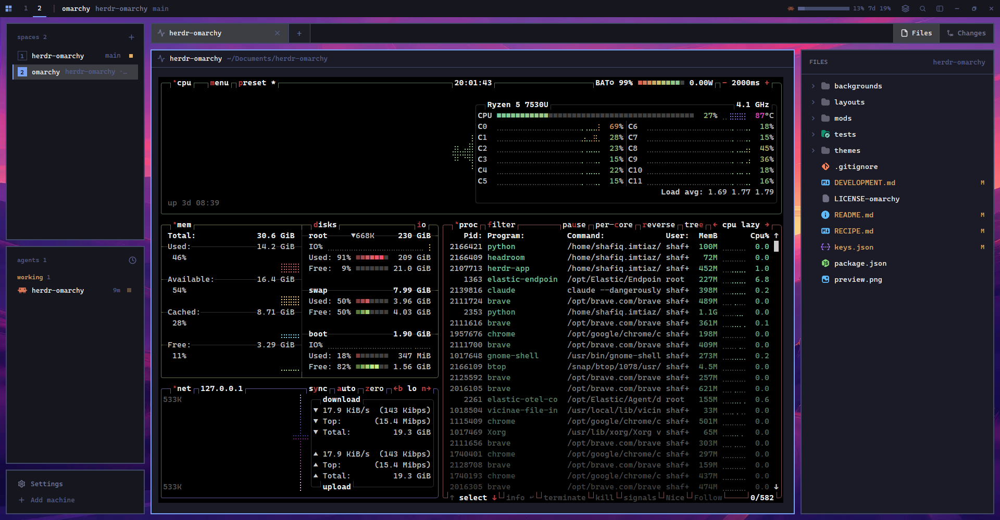

<div align="center">

# Omarchy for Herdr

**A [Herdr](https://herdr.dev) layout that looks like the [Omarchy](https://github.com/basecamp/omarchy) desktop.**

[Features](#features) · [Install](#install) · [Keys](#keys) · [What is inside](#what-is-inside) · [Development](#development)



</div>

The layout makes your Herdr window flat and square, with bordered tiles that float over a wallpaper. It shows your spaces, your agents and their status, and the AI usage of the agents on screen. A side panel shows your files, Git changes and a commit graph. Every Omarchy color theme comes with it.

## Features

- **Top bar**: shows your spaces, live AI usage for the agents on screen, and the window buttons.
- **Sidebar**: lists spaces and agents with their status. You can resize it, and you can fold it into an icon rail.
- **Tabs**: each tab shows the icons of its agents, what they work on, and their status.
- **Side panel**: shows your files with colored icons. It also shows Git changes, commits, pushes, pulls and switches branches. Changes can make a new branch, wrap long diff lines, and open a full commit graph (Graph, then ← Changes to go back). The graph shows branch lanes and labels, and its right-click menus check out, merge, rebase, reset and tag.
- **Dialogs**: the command palette, Settings, a mod manager and a Keybindings list (every key Herdr has) have the same square look. Keybindings and Mods open from the sidebar footer.
- **Themes**: the layout comes with every Omarchy color theme and its wallpapers. A theme changes the color of each part of the window and brings its own wallpaper. The theme switcher shows Omarchy's preview of each theme: ← and → choose, Enter applies.

## Install

Ask your agent in Herdr:

```text
Read ~/.config/herdr-app/AGENTS.md, then add the layout from github.com/shafiqimtiaz/herdr-omarchy.
```

The agent copies the layout, mods, themes and wallpapers into `~/.config/herdr-app`. Your own layout stays. Press `ctrl-shift-l` to change between layouts.

> [!NOTE]
> Some mods use the network or run programs:
> - `omarchy-ai-usage` reads the local login files of your AI agents (Claude, Codex, Copilot, OpenCode and Pi). It uses the tokens in them to get your usage from the API of each provider.
> - `omarchy-spaces`, `omarchy-files` and `omarchy-changes` run `git` in your folders. The commit graph in `omarchy-changes` also runs `find` to look for repos in a folder that is not one.
> - `omarchy-mod-manager` searches GitHub for mods. It runs `git` and `gh` to download and install them.

## Keys

These keys work only in the Omarchy layout. They follow Omarchy: its Herdr keymap and its desktop keys. Keys that GNOME already uses are left out. `super-k` lists every key.

| Key | Action |
| --- | --- |
| `alt-1` … `alt-9` | Go to tab 1 to 9 |
| `alt-left` / `alt-right` | Previous / next tab |
| `alt-up` / `alt-down` | Previous / next space |
| `alt-enter` / `alt-shift-enter` | Split the pane right / down |
| `super-return` | New terminal |
| `super-w` | Close the pane |
| `super-f` | Zoom the pane |
| `super-c` / `super-v` | Copy / paste |
| `super-alt-space` | Open the command palette (also `ctrl-shift-p`) |
| `super-shift-space` | Show or hide the top bar |
| `super-k` | Show every key binding |
| `super-ctrl-t` or `super-ctrl-shift-space` | Pick a theme |
| `super-ctrl-w` or `super-ctrl-space` | Change to the theme's next wallpaper |
| `ctrl-,` | Open Settings |
| `ctrl-shift-m` | Open the mod manager |
| `ctrl-shift-l` | Change to a different layout |

Left out because GNOME uses them: Omarchy Herdr's `ctrl-space` prefix (input method), `alt-esc` (cycle windows), `ctrl-alt-arrows` and `ctrl-alt-shift-arrows` (workspaces). Herdr's own `alt-h/j/k/l` still move between panes.

## What is inside

The repo has the same structure as a Herdr home folder:

| Path | Contents |
| --- | --- |
| `layouts/omarchy.json` | The layout: tile tree, sizes and spacing |
| `mods/` | One folder for each mod. Each mod installs on its own. |
| `themes/` | The Omarchy color themes |
| `backgrounds/omarchy/` | The wallpapers of each theme |
| `keys.json` | The layout keys |
| `RECIPE.md` | The full brief. An agent can build the layout again from it. |

## Development

Run the tests from the repo root. They use the Node test runner and need no install step:

```sh
npm test
```

Check each mod that you change:

```sh
herdr-app check mods/omarchy-settings
```

[`DEVELOPMENT.md`](DEVELOPMENT.md) shows which file to change for each part of the layout.

> [!TIP]
> Your edits in this repo do not change the copy in `~/.config/herdr-app`. Copy the changed files there to see them in Herdr.
