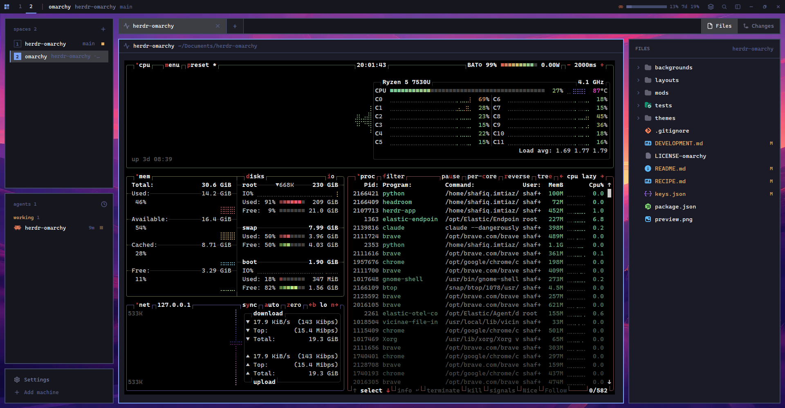

# Omarchy

The Omarchy desktop look for Herdr: flat, square, bordered tiles floating over a wallpaper. A thin top bar shows your spaces, live AI usage for the agents on screen and the window buttons. The sidebar lists spaces and agents with their status, resizes, and folds into an icon rail. A side panel browses files and Git changes, commits, pushes and switches branches. The palette, Settings and a mod manager match the look, and every Omarchy color theme comes with it.

## What you see

Top to bottom, left to right. Sizes are logical px at zoom 1. Colors below are the default `tokyo-night` theme; every color is a theme name, so the other 22 themes recolor everything.

- **Top bar** (`topbar`, 30px, `chrome` `#16161e`, drags the window):
  - **Left** (weight 1): a 2x2 grid menu icon in `accent` `#7aa2f7` (opens the palette), then the numbers 1..N, one per space. The active number is in `foreground` with a 2px `accent` underline. Others are `dim` `#565f89`, and a space with a blocked agent shows its number in `blocked` `#f7768e`. After a `│` separator come the current space name, the focused terminal's folder when it differs, its branch and `@machine` when remote.
  - **AI usage** (weight 1, right-aligned): one segment per agent provider visible in the current tab: the program icon, a 6px horizontal bar for its first window (5h for Claude and Codex) (90px wide alone, 60px for two, 40px for three or more) with its %, then the next window as plain text ("7d 11%"). The account label shows only when two Claude accounts are on screen. Each bar fills in its provider's brand color, taken from Herdr's program icons: Claude `#D97757`, Codex `#7A9DFF`, Copilot `#a371f7`. It turns amber `#ffb347` at 80% or more and red `#ff5d6c` at 95% or more. Agents without a usage API show "no usage API" in `dim`.
  - **Right** (180px): six flat 30px square buttons: Mods (layers icon), search, sidebar toggle, minimize, maximize/restore, close. Close turns `blocked` on hover.
- **Desk** (row, 10px padding and 10px gaps, wallpaper `backgrounds/omarchy-tokyo-night.jpg` shows through):
  - **Sidebar** (243px column of three tiles, each `chrome` with a 2px `border` `#414868` frame; inside each tile there is 10px of top padding like the footer, a 26px header, then the list 6px below it and 10px from the sides; header text starts 18px in to line up with row text, and header buttons sit 10px from the right):
    - **Spaces** (weight 1): header "spaces 8" and a square `+`. Rows are 26px, each with a 16px square number badge. The active row's badge is `accent` with `accent_foreground` text, the row has an 18% foreground fill and a 2px `accent` bar on its left. Other badges are `dim` numbers in a 1px `border` square. A branch name appears only when it fits whole. A space with an agent working, needing input or done ends in a 6px square in that status color. Rows have no fill at rest, only on hover and when active.
    - **Agents** (weight 1): header "agents 3", grouped "working 1", "idle 2". Rows are 26px with the program icon, the folder the agent is in now (its pane's live `cwd`, not the folder its space was started in), what the agent works on (its title, never just a program name like "Claude Code"), age, and a 7px square status dot. The focused row has an 18% fill and a 2px accent bar.
    - **Footer** (78px): "Settings" and "Add machine" rows with 10px top and bottom padding and no fill until hovered.
  - **Work column**:
    - **Tab strip** (36px tile): flat 240px cells with 1px `border` dividers. Each cell shows the agents' program icons, then what they work on (session title, else folder such as `~`, else branch; a shell's bare terminal address like `t4c` never counts as a title), a status word and a spinner while working. Program names like "Claude Code" or "Codex" never appear: the icons carry them. The active tab has an 18% fill and no bottom bar. A 36px `+` cell sits right after the last tab, and Files / Changes / Git toggles sit flush right. Every item in the strip is a full-height flat cell with a 1px `border` divider; the open panel's toggle gets the same fill as the active tab.
    - **Panes**: square, 2px `border` frame and 2px `accent` frame when focused, 10px gaps, 30px header (`omarchy-pane`) that shows the program icon and what it works on (its title, else the folder), never the program name, terminal padding 12px. Tab icons and pane header icons line up on the same left edge.
    - **Side panel** (475px, hidden until toggled): a stack of Files (`omarchy-files`, colored file-type icons and Git status colors), Changes (`omarchy-changes`, diff, Fetch/Pull/Push/Stash/Pop row with ahead/behind counts, commit box and a solid `accent` Commit button) and browser notes (`omarchy-notes`).
- **Dialogs**: the palette (`ctrl-shift-p`, 660x450), Settings (`ctrl-,`, 970x690) and Mods (`ctrl-shift-m`, 60% x 75%) are square copies of Herdr's own screens.
- **Type**: CaskaydiaMono Nerd Font for terminals and UI. UI text is 11-13px, headings up to 16px.

## How it behaves

- **Agent status**: working shows the `working` `#e0af68` color, a pulsing square in the agents list and a spinner on the tab. Blocked (needs input) is `blocked` `#f7768e`, done is `done` `#9ece6a`, and idle is a hollow `dim` square. A tab's status is the most urgent of its agents.
- **Tabs with several agents**: the cell shows up to three distinct program icons side by side and the lead agent's work as its label. The tooltip lists each agent with its own status. A tab the person renamed keeps its name.
- **AI usage follows the screen**: it shows providers for the agents in the focused tab (focused pane first, zoom respected). With no agent in view it keeps the last list, dimmed. Clicking it opens a popup with every window and its reset time. Each provider refreshes when it first appears, then every 5 minutes.
  - **Live providers**: Claude (5h and 7d, plus model-scoped weekly limits), Codex (ChatGPT plan 5h and 7d) and Copilot (monthly premium requests).
  - **Mapped**: Pi and OpenCode reuse those three when their configured provider is Anthropic, OpenAI Codex or GitHub Copilot.
  - **Labelled only**: omp, devin, droid, kimi, kilo, hermes, qodercli, qwen, letta, cursor, mastracode, antigravity-cli and grok.
  - **Claude accounts**: when two Claude config directories exist (`~/.claude`, `~/.claude-personal`), the meter matches each terminal's `CLAUDE_CONFIG_DIR` to show the right account. An account with no login is hidden.
- **Clicks**: a space number selects the space; the menu icon opens the palette; Mods opens the mod manager; search opens the picker; the sidebar toggle collapses the sidebar to a 44px rail and back. A double-click on a tab renames it, dragging reorders, and right-click opens the tab menu.
- **Side panel**: remembered per space. In a space that isn't a Git repo the Changes button is hidden and a remembered Changes panel stays closed.
- **Hover**: controls get an 8% foreground fill and a 1px border at 25% foreground alpha, after Omarchy's shell control tokens.

## Built from

- **Layout** `layouts/omarchy.json`: root `column` (theme `tokyo-night`, `font` and `ui_font` CaskaydiaMono Nerd Font, `titlebar: "none"`, background image cover, `terminal_padding` [12,12]).
  - `topbar` row: `bar-left` (`omarchy-bar` `{part:"left"}`), `ai-usage` (`omarchy-ai-usage` `{compact:true}`), `bar-right` (`omarchy-bar` `{part:"right"}`).
  - `desk` row: `sidebar` column (`spaces` → `omarchy-spaces`, `agents` → `omarchy-agents`, `sidebar-footer` → `omarchy-chrome` `{footer:true}`) and `work` column (`tabs` → `omarchy-tabs`; `work-body` row with `main` `{tab:"active"}`, whose pane header is `omarchy-pane`, and the `panel` column with stack `panel-body`: `files`, `changes`, `browser-notes`).
- **Mods** (all in `mods/`):
  - `omarchy-bar`, `omarchy-ai-usage`: new.
  - `omarchy-chrome`, `omarchy-spaces`, `omarchy-agents`: clones of Herdr's `workspace-chrome`, `spaces` and `agents`.
  - `omarchy-palette`, `omarchy-settings`: copies of Herdr's `frame/palette` and `frame/settings`, with `rounded(0)`.
  - `omarchy-mod-manager`: install, update, remove and AI-edit mods, Marketplace tab.
  - `omarchy-tabs`: based on RofieSagara/herdr-auto-tabs (Apache-2.0, see its NOTICE).
  - `omarchy-pane`, `omarchy-notes`: pane header and browser notes, which pair with the herdr-browser helper.
  - `omarchy-files`, `omarchy-changes`: colored Files and Changes panels; Charmed icons, see `CHARMED-LICENSE.md`.
- **Themes**: `themes/*.json` are the 23 Omarchy themes rendered through Omarchy's own `default/themed/herdr-app.json.tpl`, plus `canvas`/`chrome` = `dark_background` and `border` = `muted`.
- **Keys** (`keys.json`, section `layout:omarchy`): `ctrl-shift-p` → `mod.open:omarchy-palette`, `ctrl-,` → `mod.open:omarchy-settings`, `ctrl-shift-m` → `mod.open:omarchy-mod-manager`.
- **Shipped mods it borrows icons from**: `pane`, `terminals-bar`, `workspace-chrome`, `new-menu`, `menu`, `picker`, `machine-add`.
- **Herdr API it uses**: `spaces`, `agents`, `panes`, `terminals`, `focused`, `layout`, `theme`, `window`, `shared`/`setShared`, `openOverlay`, `run` (`space.select`, `tab.select`, `tab.rename`, `tab.move`, `tab.close`, `layout.show`/`hide`/`select`/`resize`, `mod.open`, `window.*`).
- **Art**: the wallpaper is Omarchy's Tokyo Night "winding road" (MIT, see `LICENSE-omarchy`), converted to JPEG at 2560x1440.

## Watch out

- **Network and programs**: check these before installing.
  - `omarchy-ai-usage` reads login files only at fetch time and never stores tokens:
    - `~/.claude*/.credentials.json`
    - `~/.codex/auth.json`
    - `~/.config/github-copilot/*.json`
    - `~/.pi/agent/auth.json`
    - `~/.local/share/opencode/auth.json`
  - It calls only the providers' own hosts: `api.anthropic.com`, `chatgpt.com`, `api.github.com`. On Linux it reads `/proc/*/environ` to match each terminal to its Claude config directory.
  - `omarchy-spaces` and `omarchy-changes` run `git`.
  - `omarchy-pane` runs `xdg-open` (Linux), `open` (macOS) or `explorer` (Windows) to open links.
  - `omarchy-notes` talks to the local herdr-browser helper (`~/.local/share/herdr-browser`).
  - `omarchy-mod-manager` runs `git`, `gh` (its Marketplace searches GitHub repos tagged `herdr-mod` and `herdr-layout`) and `herdr-app check`.
- **Herdr screen copies**: the palette and Settings copies won't follow Herdr updates to its own screens. Re-copy `frame/palette` and `frame/settings` and reapply `rounded(0)` after a big update.
- **Fixed widths**: a fresh build tends to get these wrong.
  - `bar-right` needs 180px for its six 30px buttons; at 150px the Mods button is cut off.
  - The usage meter fits about three providers before it truncates.
  - The tab strip assumes 240px cells.
- **Claude account matching**: it is Linux-only and cached per terminal. Elsewhere, both logged-in accounts show.
- **Pi and OpenCode**: they are read from their configured default provider, not the model a running session switched to.
- **Theme names**: if Omarchy itself is installed, its theme switcher writes `themes/omarchy.json` for Herdr. That theme works with this layout, but the layout's default stays `tokyo-night`.
- **Fonts**: CaskaydiaMono Nerd Font must be installed. Without it Herdr falls back to JetBrains Mono, and the layout still works.

## Done when

- `npm test` passes (mod manager core, file icons, diff and Git row) and `herdr-app check mods/<name>` passes for all 13 `omarchy-*` mods, and `herdr-app status` shows `"errors": []` with `layout: "omarchy"`.
- The top bar is one 30px row: grid icon, space numbers with the active one underlined, usage segments right-aligned with a horizontal bar each, and six square buttons. Nothing is cut off at 1920px wide.
- Spaces, agents and the footer are three separate bordered tiles with the wallpaper visible between them.
- A tab with a Codex and a Claude pane shows both icons and a session title, never "Codex" or "Claude Code", and the usage meter shows a Claude and a Codex segment.
- In a non-Git space the Changes button is missing, and in a Git repo it is back.
- `ctrl-shift-p`, `ctrl-,` and `ctrl-shift-m` open square dialogs, and picking `nord` in Settings recolors every block.
